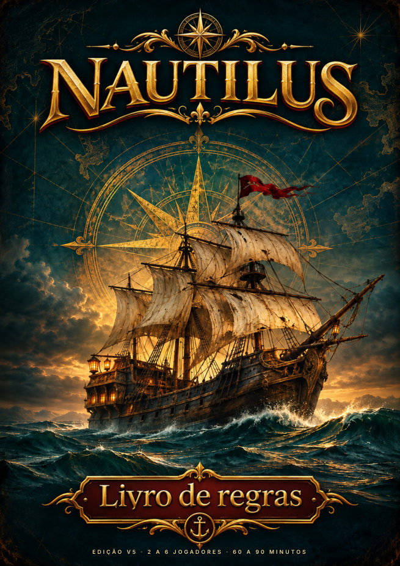
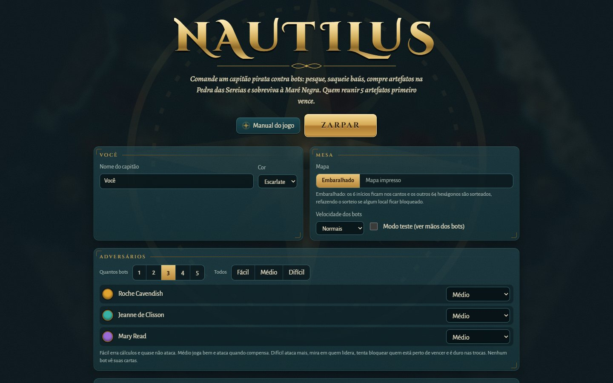
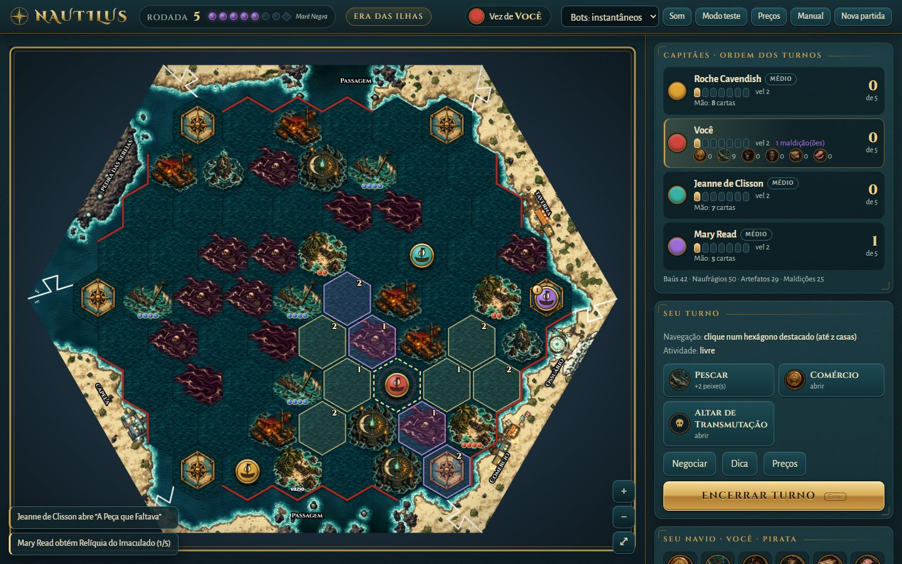
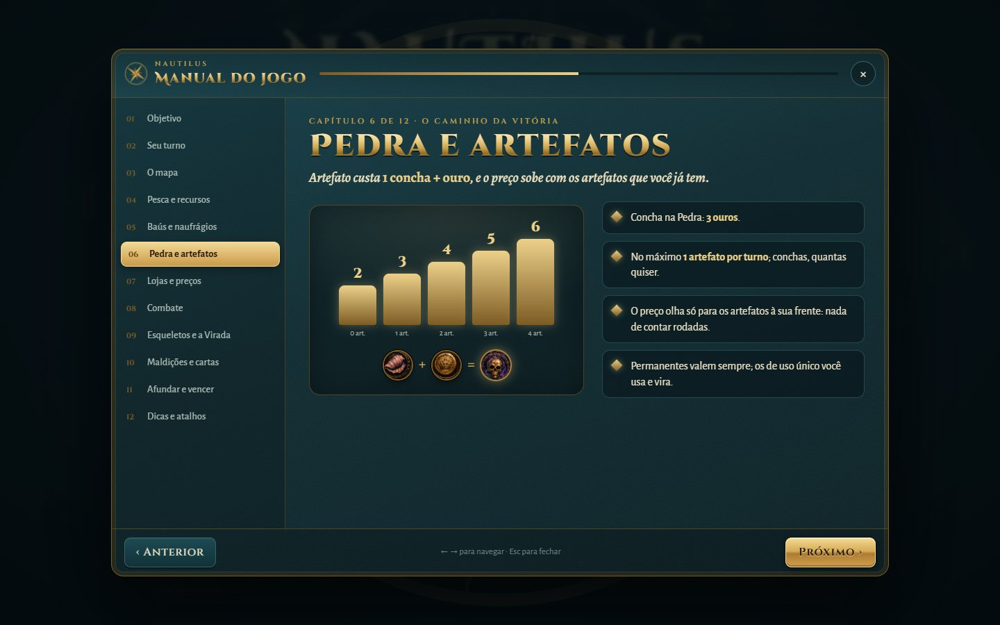
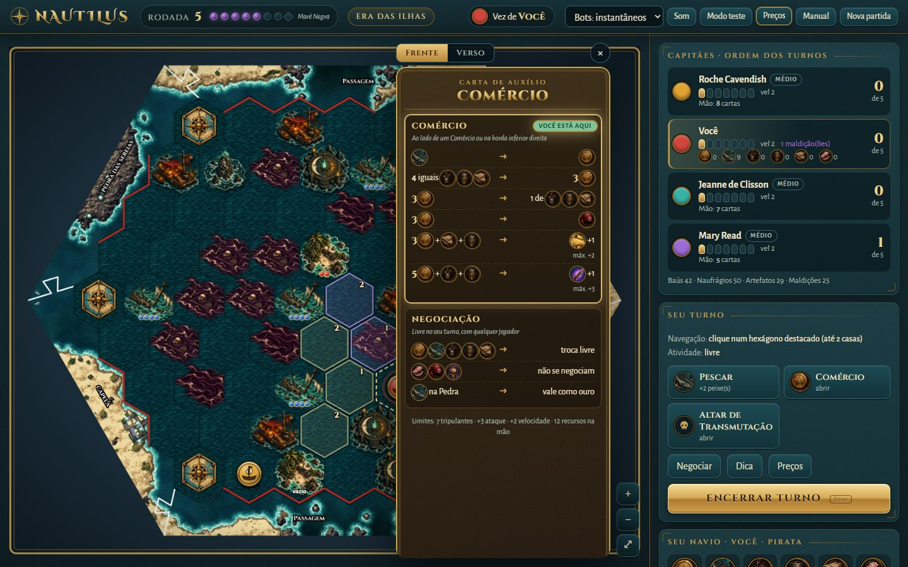
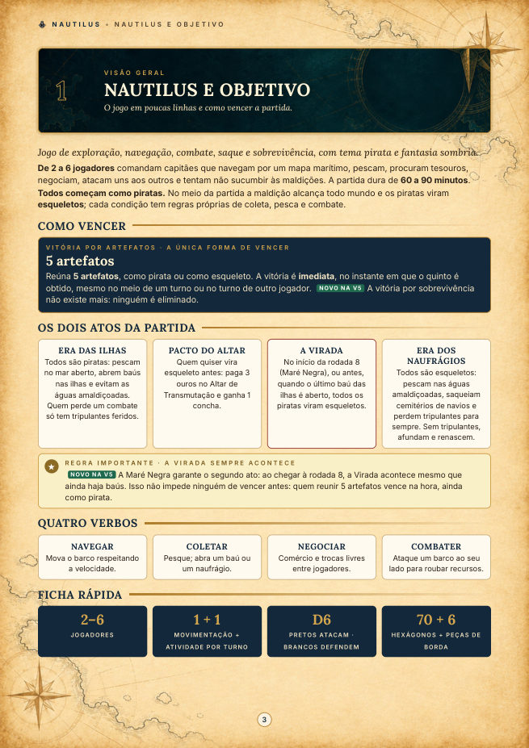
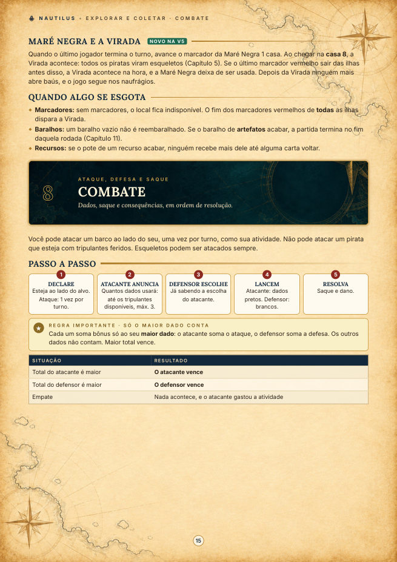
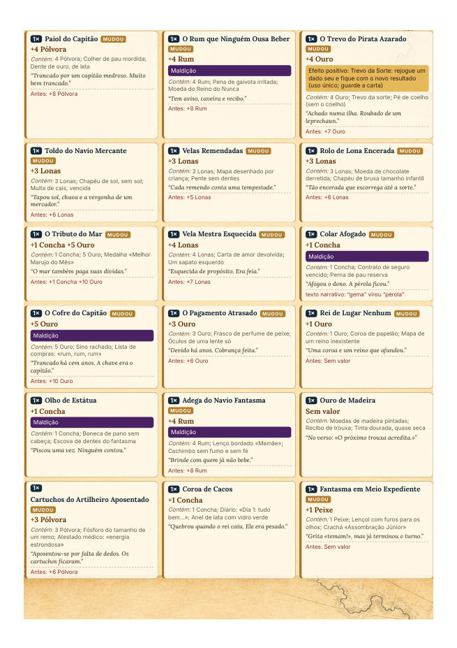
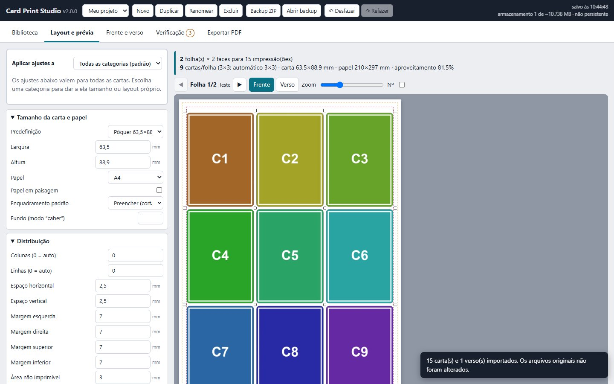
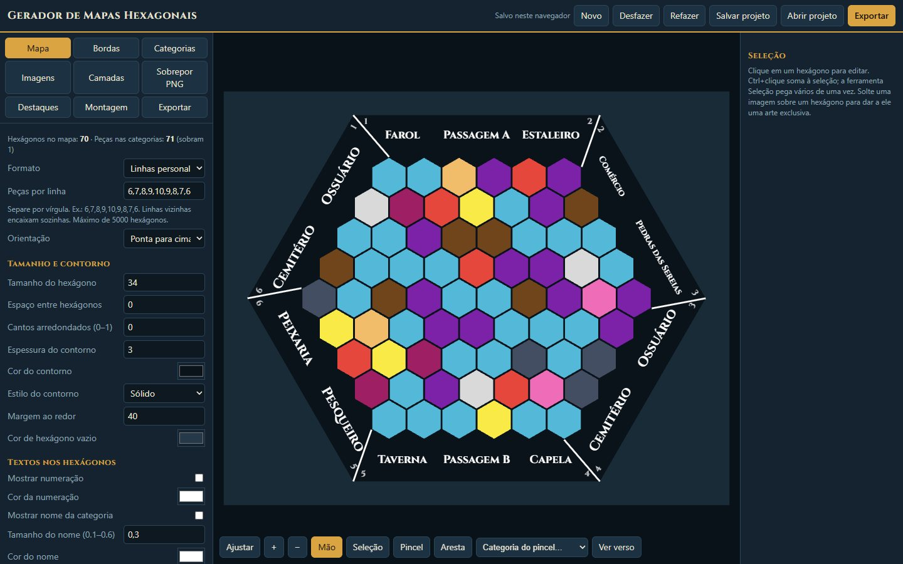

<div align="center">



# Nautilus

**Um jogo de tabuleiro pirata que está sendo feito para existir de verdade, na mesa.**
Projeto autoral em desenvolvimento ativo: regras, balanceamento, arte, arquivos de gráfica e um protótipo digital jogável.

[](#roteiro)
[](https://nautilus-jogo.pages.dev)
[](https://github.com/leoesquivelcouto/nautilus-jogo/actions/workflows/ci.yml)


**[▶ Jogar no navegador](https://nautilus-jogo.pages.dev)** ·
**[📖 Livro de regras (PDF)](docs/MANUAL_NAUTILUS_v5.pdf)** ·
**[🃏 Catálogo das 333 cartas (PDF)](docs/CATALOGO_DE_CARTAS_v5.pdf)** ·
**[🎨 Arquivo de impressão das cartas](#arquivos-de-produção)**

</div>

---

## Por que este projeto

Nautilus é um dos projetos em que estou trabalhando agora. Ele não é só um jogo de computador: é um **jogo de tabuleiro físico**, com caixa, cartas, peças e mapa, e o objetivo é chegar à gráfica.

Por isso o projeto cobre o caminho inteiro de um produto real, não só o código:

| Frente | O que foi feito |
|---|---|
| **Design de regras** | Manual completo (v5), com 12 capítulos, exemplos e referência rápida, pronto para diagramação. |
| **Balanceamento com dados** | Simulador próprio que joga milhares de partidas com bots. Cada mudança de regra foi testada antes de entrar no manual. |
| **Viabilidade de produção** | Quantidade de cada componente dimensionada pelo pico de uso medido em simulação. A caixa caiu de 378 para **333 cartas**, e 42 cartas de tripulante viraram uma trilha com cubos no tabuleiro do jogador. |
| **Tempo de partida** | O simulador estima a duração real: cerca de **58 minutos com 4 jogadores** e 73 com 6, dentro da meta de 60 a 90 minutos. |
| **Pipeline de arte e impressão** | Duas ferramentas próprias para produção: um estúdio de impressão de cartas (frente e verso, sangria, PDF para gráfica) e um gerador de mapas hexagonais. |
| **Protótipo digital** | O jogo completo no navegador contra bots, usado para playtest antes de imprimir. |

## Resultados do balanceamento

A versão 4 das regras parecia boa no papel. A simulação mostrou o contrário, e a versão 5 corrigiu cada problema com uma mudança medida:

| Problema na v4 | Mudança na v5 | Efeito medido |
|---|---|---|
| Partida acabava em 8 a 9 rodadas, decidida por quem abria mais baús | Preço do artefato em escada (2 a 6 ouros) e no máximo 1 por turno | Partidas de 13 a 15 rodadas, sem estratégia dominante |
| O "segundo ato" (a Virada) acontecia em só 2% a 5% das partidas | Maré Negra: a Virada chega na rodada 8 | Virada garantida em 100% das partidas |
| Quem joga primeiro tinha de 5 a 9 pontos percentuais de vantagem | Peixes de compensação para quem joga depois | Todas as posições a no máximo 2 pontos da chance justa |
| Uma carta (Pérola da Fortuna) dava 84% de vitória a quem a tirava cedo | Efeito reescrito | Volta à faixa saudável das outras cartas |
| Esqueleto derrotado era eliminado e ficava de fora | Afundar e renascer, entregando 1 artefato | Ninguém fica assistindo; mais combate no segundo ato |

Mais de 6.000 partidas simuladas para fechar a v5. Detalhes e como rodar em [`pesquisa/`](pesquisa/).

## O protótipo jogável

<table>
<tr>
<td width="50%"></td>
<td width="50%"></td>
</tr>
<tr>
<td></td>
<td></td>
</tr>
</table>

- **Todas as regras do Manual v5**, com as 333 cartas e todos os efeitos.
- **Bots em três níveis**: o fácil erra cálculos, o médio joga bem, o difícil ataca mais e tenta bloquear quem está perto de vencer. Nenhum vê as suas cartas.
- **Mapa sorteado a cada partida**, com validação para nenhum local ficar inacessível, ou o mapa impresso fixo.
- **Manual animado** com 12 capítulos e **carta de auxílio** com os preços, igual à da mesa.
- **Editor de regras**: mais de 30 valores ajustáveis para testar variações antes de mudar o manual.
- **Dica do imediato**: mostra o que o bot difícil faria no seu lugar.
- Animações, som sintetizado no navegador e modo de movimento reduzido.

## Arquivos de produção

| Arquivo | O que é |
|---|---|
| [`docs/MANUAL_NAUTILUS_v5.pdf`](docs/MANUAL_NAUTILUS_v5.pdf) | Livro de regras v5, 22 páginas, com a identidade visual do jogo |
| [`docs/CATALOGO_DE_CARTAS_v5.pdf`](docs/CATALOGO_DE_CARTAS_v5.pdf) | As 333 cartas: quantidade, nome, efeito, resultado e o que mudou desde a versão anterior |
| [`docs/carta-auxilio/`](docs/carta-auxilio/) | Carta de auxílio final: PDF para gráfica (70 × 104 mm com sangria) e imagens em 300 dpi |
| [Arquivo de impressão das cartas (531 MB)](https://github.com/leoesquivelcouto/nautilus-jogo/releases/latest) | Todas as cartas com arte, frente e verso, prontas para impressão. Fica na página de **Releases** por causa do tamanho. |

<table>
<tr>
<td width="33%"></td>
<td width="33%"></td>
<td width="33%"></td>
</tr>
</table>

## Ferramentas de produção

Feitas para este projeto e publicadas junto com o jogo. Rodam inteiras no navegador, sem servidor e sem conta.

| Ferramenta | Para que serve | Abrir |
|---|---|---|
| **Card Print Studio** | Monta as folhas de impressão das cartas: importa as artes, casa frente e verso, ajusta tamanho, margens e sangria, confere erros e exporta o PDF para a gráfica. | [abrir](https://nautilus-jogo.pages.dev/ferramentas/cartas/) · [código](web/public/ferramentas/cartas/index.html) |
| **Gerador de Mapas Hexagonais** | Desenha e testa montagens do mapa: formato, bordas, categorias de hexágono, camadas e exportação em imagem. | [abrir](https://nautilus-jogo.pages.dev/ferramentas/mapas/) · [código](web/public/ferramentas/mapas/index.html) |
| **Carta de auxílio** | Gera a arte da carta de preços a partir de uma tabela editável. | [abrir](https://nautilus-jogo.pages.dev/ferramentas/carta-auxilio/) · [código](web/public/ferramentas/carta-auxilio/index.html) |

<table>
<tr>
<td width="50%"></td>
<td width="50%"></td>
</tr>
</table>

## Tecnologia

- **JavaScript puro** com módulos ES, sem framework. O motor de regras roda igual no navegador e no Node, o que permite usar o mesmo código no jogo e nas simulações.
- **Vite** para o build, **Cloudflare Pages** para a hospedagem, com publicação automática a cada envio.
- **Web Animations API** e **Web Audio API** para animações e sons, sem bibliotecas.
- **Segurança desde o início**: política de segurança de conteúdo (CSP) rígida, HTTPS obrigatório, fontes servidas pelo próprio site, nenhum segredo no repositório.
- **Integração contínua** no GitHub Actions: cada envio roda partidas completas com bots e gera o site; o Dependabot acompanha as dependências.

## Estrutura do repositório

```
web/                 o jogo (index.html, código em src/, imagens e ferramentas em public/)
tests/               partidas automáticas do motor, servidor local com os cabeçalhos de produção, piloto da interface
pesquisa/simulador/  simulador de balanceamento usado para chegar à v5
docs/                livro de regras, catálogo de cartas, carta de auxílio e imagens deste README
```

## Rodar localmente

```bash
npm ci
npm run dev          # jogo em http://localhost:5173
npm test             # 60 partidas só com bots; falha se alguma quebrar
npm run build        # gera o site em dist/
```

## Roteiro

- [x] Regras v5 balanceadas por simulação
- [x] Livro de regras e catálogo de cartas
- [x] Carta de auxílio final para a gráfica
- [x] Protótipo digital jogável, publicado
- [ ] Contas de jogador e partidas salvas na nuvem (Supabase)
- [ ] Playtests presenciais com o protótipo impresso
- [ ] Arte final das cartas novas (ouro, naufrágios novos) e orçamento de gráfica
- [ ] Multiplayer online

## Autor

**Leonardo Esquivel Couto**, criador do jogo, das regras e das ferramentas. Projeto em andamento.

<sub>Nautilus, suas regras, textos e artes são de autoria de Leonardo Esquivel Couto. Todos os direitos reservados; veja [LICENSE](LICENSE).</sub>
