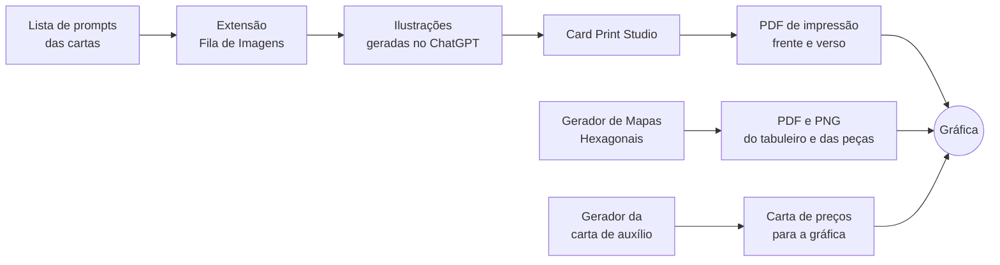

# Ferramentas de produção do Nautilus

Um jogo de tabuleiro físico precisa de centenas de ilustrações, folhas de impressão com frente e verso alinhados e um mapa que funcione na mesa. Fazer isso à mão, carta por carta, não escala. Por isso o projeto tem ferramentas próprias, cada uma para uma etapa do caminho entre a ideia e a gráfica:



Todas rodam inteiras no computador de quem usa: sem servidor, sem conta e sem enviar arquivos para lugar nenhum.

| Ferramenta | Etapa | Onde está | Usar |
|---|---|---|---|
| [Extensão Fila de Imagens](#1-extensão-fila-de-imagens-para-o-chatgpt) | Gerar as ilustrações | [`extensao-fila-de-imagens/`](extensao-fila-de-imagens) (repositório próprio) | instalar no Chrome |
| [Card Print Studio](#2-card-print-studio) | Montar o PDF de impressão das cartas | [`web/public/ferramentas/cartas/`](../web/public/ferramentas/cartas/index.html) | [abrir no navegador](https://nautilus-jogo.pages.dev/ferramentas/cartas/) |
| [Gerador de Mapas Hexagonais](#3-gerador-de-mapas-hexagonais) | Desenhar e exportar o tabuleiro | [`web/public/ferramentas/mapas/`](../web/public/ferramentas/mapas/index.html) | [abrir no navegador](https://nautilus-jogo.pages.dev/ferramentas/mapas/) |
| [Gerador da carta de auxílio](#4-gerador-da-carta-de-auxílio) | Arte da carta de preços | [`web/public/ferramentas/carta-auxilio/`](../web/public/ferramentas/carta-auxilio/index.html) | [abrir no navegador](https://nautilus-jogo.pages.dev/ferramentas/carta-auxilio/) |

---

## 1. Extensão Fila de Imagens para o ChatGPT

**O problema:** o Nautilus tem 333 cartas e dezenas de ilustrações diferentes. Gerar cada uma no ChatGPT significava colar um prompt, esperar a imagem, conferir e colar o próximo, dezenas de vezes seguidas.

**A solução:** uma extensão do Chrome que recebe uma lista de prompts numerados, separa cada um e gera as imagens **uma por vez**, na interface normal do ChatGPT e na conta que já está aberta. O próximo prompt só é enviado depois que a imagem anterior foi realmente gerada.

- **Fila com pausa e retomada.** O progresso fica salvo; se o popup fechar ou a aba recarregar, a fila volta pausada, sem perder o ponto em que estava.
- **Nunca avança no chute.** A conclusão de cada imagem é confirmada por vários sinais ao mesmo tempo (imagem nova carregada, botão de parar sumido, página estável). Na dúvida, a fila pausa. Nada é reenviado sozinho, então nenhuma imagem é duplicada nem gasta à toa.
- **Leitor de prompts conservador.** Números dentro do texto (`1024x1536`, `3.5 mm`) não quebram a lista; casos ambíguos viram aviso antes de a fila começar.
- **Permissões mínimas** (Manifest V3): só armazenamento local e os domínios do ChatGPT. Sem API paga e sem servidor.
- **Testada:** 18 testes de unidade no leitor de prompts e um teste de integração contra uma página que imita o ChatGPT.

Ela tem repositório próprio, [leoesquivelcouto/nautilus](https://github.com/leoesquivelcouto/nautilus), e entra aqui como submódulo: a pasta `extensao-fila-de-imagens/` aponta para a versão publicada lá, sem duplicar o código. Para baixar junto com este repositório:

```bash
git clone --recurse-submodules https://github.com/leoesquivelcouto/nautilus-jogo.git
```

O README da extensão explica a instalação no Chrome (modo desenvolvedor) e o uso passo a passo.

> A extensão só digita e envia prompts na interface que o usuário já usa, no ritmo normal. Ela não contorna limites, login nem verificações. Projeto pessoal, sem vínculo com a OpenAI.

---

## 2. Card Print Studio

**O problema:** imprimir cartas em casa ou na gráfica exige folhas com várias cartas, frente e verso que se encontrem exatamente no mesmo lugar, sangria para o corte e marcas de corte. Montar isso num editor de imagem, carta por carta, é lento e cheio de erro.

**A solução:** um estúdio no navegador que pega as ilustrações e gera o **PDF de impressão pronto**.

- **Biblioteca de cartas:** importa imagens soltas, uma pasta inteira ou um ZIP; organiza por categoria (baús, naufrágios, artefatos...); define quantas cópias de cada carta (também por uma lista CSV).
- **Frente e verso automáticos:** um arquivo `nome_verso.png` vira o verso da carta `nome`. Cada categoria pode ter um verso padrão.
- **Layout e prévia:** tamanho da carta (pôquer 63,5 × 88,9 mm e outras predefinições), papel, margens, espaçamento, área não imprimível e quantas cartas cabem por folha, com a prévia de cada folha.
- **Pronto para gráfica:** sangria, marcas de corte e alinhamento do verso espelhado para impressão frente e verso.
- **Verificação antes de exportar:** avisa sobre resolução baixa (calcula os DPI efetivos de cada imagem no tamanho final), cartas sem verso e outros problemas.
- **Projetos:** vários projetos salvos no próprio navegador, desfazer e refazer, backup em ZIP para levar para outro computador.
- **Funciona sem internet** e tem autotestes embutidos.

O arquivo de impressão das cartas do Nautilus, na [página de Releases](https://github.com/leoesquivelcouto/nautilus-jogo/releases/latest), foi gerado com ele.

A [primeira versão](../web/public/ferramentas/cartas/primeira-versao/index.html) fica guardada como histórico. Ela já montava as folhas e o PDF ([abrir](https://nautilus-jogo.pages.dev/ferramentas/cartas/primeira-versao/)). A versão atual acrescentou a verificação de resolução, os projetos, o backup e a exportação sem depender de internet.

---

## 3. Gerador de Mapas Hexagonais

**O problema:** o tabuleiro do Nautilus é um grande hexágono com 70 peças hexagonais e 6 peças de borda. Para decidir quantas peças de cada tipo usar, onde ficam os locais de borda e como o mapa fica na mesa, é preciso montar e remontar muitas vezes.

**A solução:** um editor de mapas hexagonais no navegador.

- **Formato livre:** quantidade de peças por linha (o Nautilus usa 6, 7, 8, 9, 10, 9, 8, 7, 6), tamanho, espaçamento, contorno e orientação dos hexágonos.
- **Bordas:** os 6 lados com seus nomes e marcações (Passagens, Taverna, Comércio e Ossuário, Capela, Pedra das Sereias).
- **Categorias e imagens:** cada tipo de hexágono (mar aberto, águas amaldiçoadas, ilhas, cemitérios, Comércio, Pedra, Altar) com sua quantidade e sua arte; o editor confere se o total de peças bate com o mapa.
- **Pintura e montagem:** pincel por categoria, seleção de vários hexágonos, embaralhar posições e orientações para simular a montagem aleatória da mesa.
- **Camadas, destaques e sobreposição de PNG** para testar arte por cima do mapa.
- **Exportação:** PNG e PDF do mapa inteiro, e as peças separadas em PDF ou em ZIP de PNGs para a gráfica.
- **Projetos** salvos no navegador, com desfazer, refazer e arquivo de projeto para abrir em outro computador.

Foi com ele que a composição do mapa foi testada antes de chegar ao mapa atual do jogo.

---

## 4. Gerador da carta de auxílio

Gera a arte da carta de preços (Comércio na frente; Pedra das Sereias, Taverna, Ossuário, Capela e Altar no verso) a partir de uma tabela editável no começo do código. Mudou um preço nas regras, a carta sai atualizada no formato de gráfica, 70 × 104 mm com 3 mm de sangria. A versão final está em [`docs/carta-auxilio/`](../docs/carta-auxilio/).
